  

Hi! 👋

My name is Kamila. Computer engineering sophomore @Purdue, West Lafayette.

I work in Purdue's IDEAS robotics lab on humanoid control, training whole-body motion policies and researching human-humanoid collaboration.

Co-author of MIME (under review at WACV 2027) and a contributor to [vLLM-Omni](https://github.com/vllm-project/vllm-omni/pulls?q=is%3Apr+author%3Akuatovakamila+is%3Amerged) with 3 merged PRs. I also built [AMS](https://tryams.co), a full-stack platform for a health-check telemedicine device and security camera monitoring (FastAPI + React).

